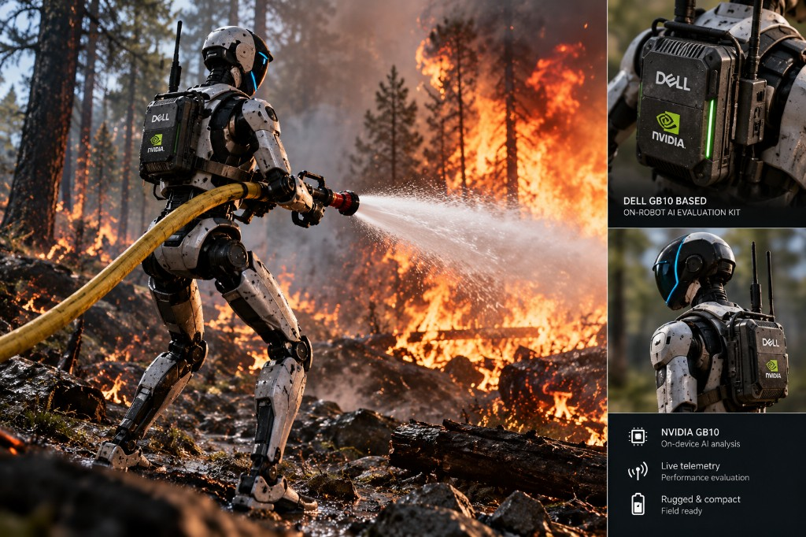
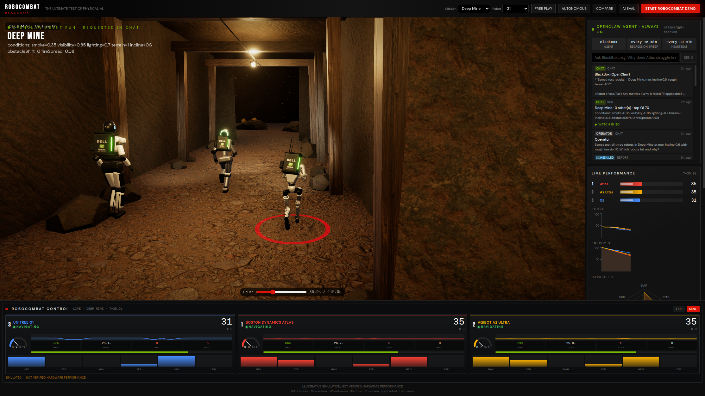

# RoboCombat BlackBox



**THE ULTIMATE TEST OF PHYSICAL AI.**

**BlackBox is an always-on AI robot test engineer that lives on a Dell Pro Max GB10.**
It is an [OpenClaw](https://docs.openclaw.ai) agent running 100% local inference
(`gpt-oss:20b` on the GB10 GPU via Ollama, no cloud). Around the clock it runs
regression sweeps on humanoid robots (Unitree G1, Boston Dynamics Atlas, AgiBot A2
Ultra) in Fire Rescue and Deep Mine missions, catches failures, investigates them
with controlled follow-up experiments, and files shift reports. Operators can
ask it anything in chat, and every experiment it runs plays back live in a 3D
simulator.



> **ILLUSTRATIVE SIMULATION, NOT VERIFIED HARDWARE PERFORMANCE.**

## The always-on agent

| | |
|---|---|
| Agent runtime | OpenClaw gateway, installed as a systemd user service (`openclaw-gateway`) |
| Model | `ollama/gpt-oss:20b`, local on the GB10 GPU. No cloud keys configured anywhere. |
| Always-on work | `RoboCombat regression sweep` automation every 15 min + OpenClaw heartbeat every 30 min |
| On demand | Chat from the dashboard (or the OpenClaw Control UI / `openclaw agent`) |
| Skill | [`openclaw/skills/robocombat-lab`](openclaw/skills/robocombat-lab/SKILL.md) |
| Persona | [`openclaw/workspace/SOUL.md`](openclaw/workspace/SOUL.md), [`HEARTBEAT.md`](openclaw/workspace/HEARTBEAT.md) |
| Lab API the agent drives | `/api/agent/run`, `/api/agent/sweep`, `/api/agent/report`, `/api/agent/brief` (compact plain-text digests sized for a local 20B model) |

What a shift looks like:

1. The scheduler wakes BlackBox. It calls `/api/agent/sweep`: every robot runs 3 stress profiles per mission (e.g. dense smoke, max incline + rough terrain).
2. The sweep flags robots that fail or fall >15% below their running average.
3. BlackBox writes a shift report with evidence and a severity (`info` / `warn` / `critical`) to the lab feed.
4. Each run appears in the dashboard feed and auto-plays in 3D, so the lab screen always shows what the agent is doing.

Example operator exchange (real output, local gpt-oss:20b):

> **Operator:** Stress test all three robots in Deep Mine at max incline 0.6 with rough terrain 1.0. Which robots fail and why?
>
> **BlackBox:** Unitree G1 **pass** (score 70, energy left 22%). Boston Dynamics Atlas **fail** (complete = NO, energy 0%, 13 collisions). AgiBot A2 Ultra **fail** (complete = NO, energy 0%, 20 collisions). Atlas and A2 ran out of energy before the final objectives.

### Set up the agent on a GB10

```bash
# Ollama with the local model
OLLAMA_FLASH_ATTENTION=1 OLLAMA_KEEP_ALIVE=-1 ollama serve &
ollama pull gpt-oss:20b

# App
npm install && npm run build && npm start      # http://localhost:3000

# OpenClaw (Node >= 24): installs, onboards to local Ollama, installs skill + persona + automation
./scripts/setup-openclaw.sh
sudo loginctl enable-linger $USER               # keep the gateway running after logout
```

Tool-search is disabled and the tool profile is `coding` so the local 20B model
sees a small, explicit tool surface. That makes its tool calls reliable.

### Sandboxed mode: NVIDIA NemoClaw + OpenShell

The same BlackBox agent also runs inside a **NemoClaw sandbox** (`blackbox`):
OpenClaw in an OpenShell container on the GB10 (sandbox GPU enabled, CUDA
verified), with inference routed through NemoClaw's local proxy to the same
Ollama `gpt-oss:20b`. The dashboard chat has a runtime switch: **OpenClaw ·
host** or **NemoClaw · OpenShell sandbox**.

The sandbox is deny-by-default. One custom preset
([`openclaw/nemoclaw/robocombat-lab-preset.yaml`](openclaw/nemoclaw/robocombat-lab-preset.yaml))
opens exactly `GET/POST /api/agent/**` on `host.openshell.internal:3000`, for
`/usr/bin/curl` only. Everything else is blocked at L7, for example:

```text
$ nemoclaw blackbox exec -- curl http://host.openshell.internal:3000/api/robots
{"detail":"GET host.openshell.internal:3000/api/robots denied by L7 policy","error":"policy_denied"}
```

```bash
curl -fsSL https://www.nvidia.com/nemoclaw.sh -o nemoclaw.sh
NEMOCLAW_AGENT=openclaw NEMOCLAW_PROVIDER=ollama NEMOCLAW_MODEL=gpt-oss:20b \
NEMOCLAW_SANDBOX_NAME=blackbox NEMOCLAW_NON_INTERACTIVE=1 NEMOCLAW_YES=1 \
NEMOCLAW_POLICY_MODE=suggested NEMOCLAW_ACCEPT_THIRD_PARTY_SOFTWARE=1 bash nemoclaw.sh
nemoclaw blackbox skill install openclaw/nemoclaw/skills/robocombat-lab
nemoclaw blackbox policy add --from-file openclaw/nemoclaw/robocombat-lab-preset.yaml --yes
node scripts/sandbox-bridge.mjs &   # exposes the app only on the Docker bridge (172.18.0.1:3000)
```

## Quick start

```bash
npm install
npm run dev
```

Open [http://localhost:3000](http://localhost:3000).

Production:

```bash
npm run build && npm start
```

Tests (deterministic simulation + evaluator):

```bash
npm test
```

## What works

- **Fire Rescue** (container ship at sunset, ocean, engine-room fire with smoke, embers and extinguisher spray) & **Deep Mine** (rock tunnels, timber sets, rails, lamps, dust) missions
- Skeletal-animated armoured humanoids carrying the Dell GB10 evaluation-kit backpack; walk/run/idle blended from real ground speed, task poses for spraying and hauling
- PBR materials, HDRI lighting, soft shadows, ambient occlusion, bloom and ACES tone mapping
- `START ROBOCOMBAT DEMO` is fully hands-off: robots run both missions on their own, an automatic director camera cuts between shots, the local LLM analyses results in the background, and a results screen closes it out
- Free play (WASD), autonomous missions, 3-robot compare, AI evaluation
- Deterministic seeded simulation engine (A* navigation, FSM tasks, fire/mine physics)
- Scores from measured telemetry only
- Live GPU panel via `nvidia-smi` when present (otherwise honest **N/A**)
- Local LLM evaluator (Ollama / OpenAI-compatible); heuristic fallback if unavailable — never fakes AI text
- Leaderboard persistence under `data/`
- Discord/NemoClaw integration **prepared** (env vars); not marked complete until a real Discord round-trip

## Controls

| Key | Action |
|-----|--------|
| WASD | Move (free play) |
| Shift | Run |
| Mouse | Camera look (click canvas to capture) |
| Wheel | Zoom |
| C | Cycle camera modes |
| 1 / 2 / 3 | Select G1 / Atlas / A2 Ultra |
| Esc | Pause |

## Local AI (GB10)

```bash
# Ollama on the GB10 GPU (gpt-oss:20b, ~14 GB)
OLLAMA_FLASH_ATTENTION=1 OLLAMA_KEEP_ALIVE=-1 OLLAMA_NUM_PARALLEL=4 ollama serve
ollama pull gpt-oss:20b
```

`.env.local` used on the GB10:

```bash
LOCAL_LLM_URL=http://127.0.0.1:11434
LOCAL_LLM_MODEL=gpt-oss:20b
LOCAL_LLM_THINK=low          # reasoning tokens count toward the output budget
LOCAL_LLM_MAX_TOKENS=2048
LOCAL_LLM_TIMEOUT_MS=120000
```

Copy `.env.example` → `.env.local` for Discord / LLM settings. Never commit secrets.

## OpenClaw status

`GET /api/agent` returns gateway health, the configured model, the scheduled
automations and the agent activity log. Chat channels (Discord, Slack, Telegram)
can be attached with `openclaw channels`; the demo uses the dashboard chat and
the OpenClaw Control UI.

## Architecture

| Layer | Role |
|-------|------|
| Next.js UI + R3F | Game view, HUD, GPU/AI panels |
| `lib/simulation` | Headless deterministic experiments |
| `lib/ai` | Local inference + autonomous follow-ups |
| `lib/hardware` | nvidia-smi / system metrics |
| `lib/agent` + `/api/agent/*` | OpenClaw agent bridge: lab tools, activity log, chat relay, 3D replay |
| `openclaw/` | Skill, persona and heartbeat installed into the OpenClaw workspace |
| `lib/nemo` | Legacy intent bridge / status probe |
| `lib/sensors` | Future physical BlackBox observation interface |

## Real vs simulated vs planned

| Item | Status |
|------|--------|
| Robot locomotion & missions | Simulated (deterministic engine + 3D viz) |
| Manufacturer rankings | Simulated / illustrative only |
| GPU metrics | Real when NVIDIA driver present |
| AI analysis | Real local LLM when available; else labeled heuristic |
| OpenClaw always-on agent | **Real**: gateway service, scheduled sweeps, chat, tested end to end on the GB10 |
| Discord channel | Not connected (optional; OpenClaw supports it via `openclaw channels`) |
| Physical robot sensors | Interface stubbed for future BlackBox hardware |

See [PROGRESS.md](./PROGRESS.md) for acceptance criteria.

## Asset credits

- HDRI sky and PBR textures: [Poly Haven](https://polyhaven.com) (CC0)
- Unitree G1 body: official meshes from [unitreerobotics/unitree_ros](https://github.com/unitreerobotics/unitree_ros) (BSD-3-Clause, see `public/models/g1/LICENSE`), baked onto the rig by `scripts/build-g1-model.py`
- Humanoid rig and animations: `Xbot.glb` from the [three.js examples](https://github.com/mrdoob/three.js/tree/dev/examples/models/gltf) (Mixamo)
- Ocean normal map: three.js examples
